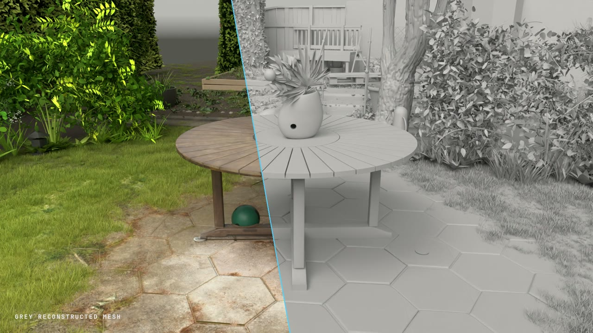
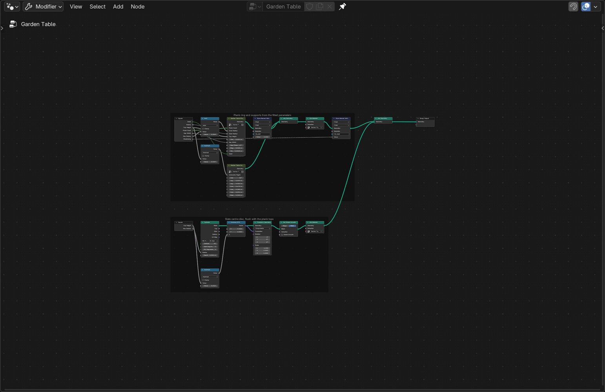

# World to World Mapping

**Gaussian splat to Blender nodes — reconstruct geometry, then optionally map captured appearance.**

A project-independent agent skill and toolkit for measured reconstruction with native
**Geometry Nodes, Shader Nodes and calibrated multi-view texture projection**. Built from
the Garden study, in the spirit of [video-to-blender](https://github.com/gokayfem/video-to-blender)
and [shader-skills](https://github.com/gokayfem/shader-skills).

<p align="center">
  
</p>

[Watch the release video — grey/textured reveals and a matched 360° comparison](https://v3b.fal.media/files/b/0aafb407/k_VXzVOBiFnE1RwnpVGxF_world_to_world_mapping-gaussian_splat_to_blender_nodes.mp4)
· [Read the skill](skills/gaussian-splat-to-blender-nodes/SKILL.md)
· [Reusable prompts](prompts/README.md)
· [Hybrid mapping guide](skills/gaussian-splat-to-blender-nodes/references/hybrid-projection.md)

*The video shows the accepted Garden c26b hybrid experiment. Its mapped table and paving
are baked evaluated meshes with packed appearance textures; other reconstructed parts retain
node-based construction. The source scan and fitted hybrid assets are not bundled. See
[media provenance and limitations](gallery/README.md). The installation name remains
`gaussian-splat-to-blender-nodes`.*

## What it does

This is an **agent-guided reconstruction workflow**, not a one-click splat-to-mesh converter.
The splat provides observations; the output describes objects through meaningful geometry,
parameters and materials that you can edit in Blender.

```text
Splat reference → measured frame + cameras → semantic scene parts
               → Geometry Nodes + Shader Nodes → native audit + visual comparison
               → optional calibrated appearance mapping → hybrid review + packed blend
```

| Included | Purpose |
|---|---|
| Installable agent skill | Acquisition, registration, construction, detail and candid critique |
| Project-agnostic prompt pack | Full brief, whole-scene capture, part contracts, detail, critique and delivery |
| Asset inspector | SHA-256 and limited PLY / SPLAT / KSPLAT metadata |
| Shared camera tools | Validated coordinates and repeatable world/scan orbit manifests |
| Native-scene audit | Remove the reference in memory; compare mesh and instance signatures |
| Blender renderer | Sequential rendering of a shared camera manifest |
| Still/video comparison | Strict frame pairing, labels and hashed evidence; optional FFmpeg MP4 |
| Synthetic starter | Small editable GN table; no scan download required |
| Hybrid mapping tools | UV preparation, depth/object visibility, robust projection, material-aware fallback and packed assembly |
| Hybrid prompt/config | Per-project objects, material slots, cameras, source masks and appearance mode |
| Garden study | Seven procedural parts, parameters and vendored node-building helpers |

No automatic semantic segmentation, universal splat decoder or reference renderer is bundled.
An audit pass proves specific structural checks; it does not prove visual resemblance.

## Install

### Agent Skills

```sh
npx skills add gokayfem/gaussian-splat-to-blender-nodes
```

### Claude Code plugin

```text
/plugin marketplace add gokayfem/gaussian-splat-to-blender-nodes
/plugin install gaussian-splat-to-blender-nodes@gaussian-splat-to-blender-nodes
```

### Manual / Codex

```sh
git clone https://github.com/gokayfem/gaussian-splat-to-blender-nodes.git
cd gaussian-splat-to-blender-nodes
mkdir -p ~/.codex/skills
cp -R skills/gaussian-splat-to-blender-nodes ~/.codex/skills/
```

For Claude project-local use, copy the skill into `.claude/skills/`. See
[adapters](adapters/README.md) for other agents. A skill-only install includes tools and the
starter; clone the full repository for Garden.

## Try it without a scan

Requires **Python 3.10+** and **Blender 5.0+**. Local integration verification used Blender
5.0.1; validate other versions before relying on them. Substitute your Blender executable
for `blender` if it is not on PATH.

```sh
S=skills/gaussian-splat-to-blender-nodes

blender -b --factory-startup --python-exit-code 1 \
  --python "$S/templates/starter.py" -- --out outputs/starter.blend

blender -b --factory-startup outputs/starter.blend --python-exit-code 1 \
  --python "$S/scripts/audit_blend.py" -- --out outputs/starter-audit.json

python3 "$S/scripts/cameras.py" --frames 4 --radius 3 --target 0 0 0.5 \
  --width 640 --height 480 --out outputs/starter-cameras.json

blender -b --factory-startup outputs/starter.blend --python-exit-code 1 \
  --python "$S/scripts/render_manifest.py" -- \
  --manifest outputs/starter-cameras.json --out outputs/starter-views
```

Width and Depth controls change the tabletop and supports. The starter is a pipeline test,
not a reconstructed asset. The audit deletes its hidden synthetic reference point in memory
and leaves the saved file unchanged.

## Reconstruct your scene

Use the [full prompting guide](prompts/README.md), starting with the
[copy-ready project brief](skills/gaussian-splat-to-blender-nodes/templates/prompts/project-brief.md).
It generalizes the actual structure used for the study: source selection and whole-scene
capture, shared measurements/cameras, scoped part builders, integrated blockout, detail
correction and final evidence. It works for other scene types and with a single agent.

The [capture guide](skills/gaussian-splat-to-blender-nodes/references/whole-scene-capture.md)
explains how repeatable reference views came from the original splat: viewer/asset identity,
exact camera and canvas settings, settled captures, shared world coordinates, coverage views,
analysis maps and matched close-ups. This is reference capture, not splat training.

For a shorter starting message, give your agent an authorized source, intended views and a
quality target:

> Use gaussian-splat-to-blender-nodes. Reconstruct this scene as editable native Blender
> geometry and materials. First fingerprint the asset, establish a measured coordinate
> frame, match the reference camera and identify the major objects. Build an integrated
> coarse checkpoint before fine detail. Review side, opposite and detail views; be candid
> about mismatches. Deliver source, parameters, blend and scan-removal evidence.

Start with the [skill workflow](skills/gaussian-splat-to-blender-nodes/SKILL.md).
Use the [part contract](skills/gaussian-splat-to-blender-nodes/templates/prompts/part-contract.md),
[detail pass](skills/gaussian-splat-to-blender-nodes/templates/prompts/detail-pass.md) and
[review prompt](skills/gaussian-splat-to-blender-nodes/templates/prompts/review-and-correction.md)
as the project progresses.
For a turntable, follow the [matched 360° guide](skills/gaussian-splat-to-blender-nodes/references/comparison-videos.md).
Reference frames must come from a compatible viewer using the same camera manifest;
the Blender renderer handles the native side.

## Map captured appearance onto your reconstruction

Use the [hybrid mapping prompt](skills/gaussian-splat-to-blender-nodes/templates/prompts/hybrid-projection.md)
when captured appearance is part of the intended result. Supply your own reconstructed
scene and calibrated captures, then fill the
[configuration template](skills/gaussian-splat-to-blender-nodes/templates/projection.json).
Objects, materials, cameras, visibility masks and rejection rules are configuration inputs;
the implementation contains no required Garden objects or fitted scene coordinates.

The [step-by-step guide](skills/gaussian-splat-to-blender-nodes/references/hybrid-projection.md)
covers the three commands: **prepare → project → assemble**. Install `requirements.txt` for
the NumPy/SciPy/Pillow projector. Blender prepares evaluated UV surfaces and visibility maps;
ordinary Python maps the captures; Blender packs the results onto selected mesh copies.
Unseen/rejected texels retain the original material. Source-only occluders require masks or
other explicit evidence; reconstructed depth alone cannot identify them.

Choose unlit captured radiance or an approximate irradiance-divided lit material. Neither
recovers clean physical albedo. Selected mapped surfaces require rebaking after geometry or
UV edits; untouched procedural parts retain their live graphs. The original source is
preserved, and immutable manifests tie geometry, captures and outputs together.

## Garden example

Garden generates ground, table, vase/arrangement, tree, shrubs, boundary and structures
from nodes. It includes fitted parameters and a sparse foliage control field, not the
original Gaussian records. The default build requires no scan download.

<details>
<summary>View the table's editable Geometry Nodes graph</summary>



</details>

[Build instructions, provenance and limitations →](prompts/garden/README.md)

The reference is the Mip-NeRF 360 Garden scene displayed by GaussianSplats3D. Original scans,
decoded arrays and reference captures are not distributed here. No claim of perfect
replication is made: construction, foliage, surface response and light still differ visibly.

## Development

```sh
python3 -m pip install -r requirements.txt
python3 -m unittest discover -s tests -v
python3 tests/check_repository.py
```

Tests cover coordinate invariants, malformed assets, comparison pairing, projection visibility,
linear-light blending, material boundaries, fallback and artifact fingerprints. Blender checks
are documented in [tests](tests/README.md). Python CI alone does not validate rendering.
See [AGENTS.md](AGENTS.md) for contributor rules.

## Credits and license

MIT for repository code and instructions. Vendored nodekit/library retain their
[original license](prompts/garden/vendor/LICENSE.video-to-blender).
Datasets and third-party media retain their own terms; the code license does not grant
rights to those assets. See [CREDITS.md](CREDITS.md).
